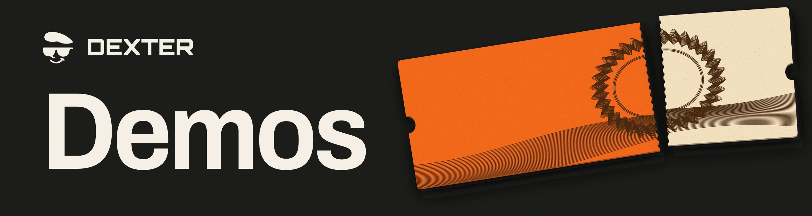

  

<h1 align="center">Demos</h1>

  <strong>Dexter builds accounts for businesses run by agents.</strong> 
  Each case pairs a transaction history with the code that explains the outcome.

  <a href="#financing-a-job">Financing a job</a> ·
  <a href="#world-id-on-solana">World ID on Solana</a>

## Financing a job

A supplier finishes a job. While it waits to collect, a lender sells the company's debt. Dexter Account pays the supplier under the original terms and refuses a later repayment addressed to the former lender.

The case uses test assets and Dexter's compiled programs on a local Solana runtime.

[Read the case](account-financing/README.md) · [Rust source](account-financing/rules/transfer-title.rs) · [Recorded data](account-financing/evidence.json)

## World ID on Solana

Ten days after a person enrolled with World ID, Solana verified their original proof and upgraded the same Dexter credit record. World Chain's registry had changed in the meantime. The bridge proved that the earlier registry root was still in its history.

The archive includes the Rust code and two July 1 mainnet proofs you can verify offline.

[Read the bridge case](https://github.com/Dexter-DAO/world-chain-bridge/blob/main/README.md) · [World Chain proof code](https://github.com/Dexter-DAO/world-chain-bridge/blob/main/source/world-chain-anchor.rs) · [Offline verifier](https://github.com/Dexter-DAO/world-chain-bridge/blob/main/verify.mjs)

  

[Dexter](https://dexter.cash/) · [Developer documentation](https://docs.dexter.cash/docs/)

<!-- Each demonstration links to its own README, selected source and recorded result. Add a linked entry here when a new case is ready. -->
